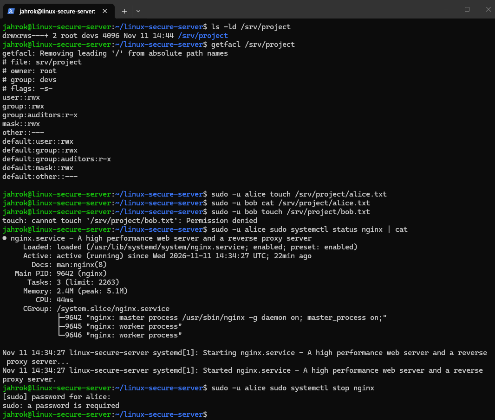
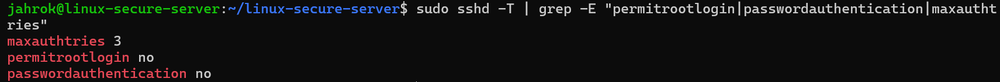
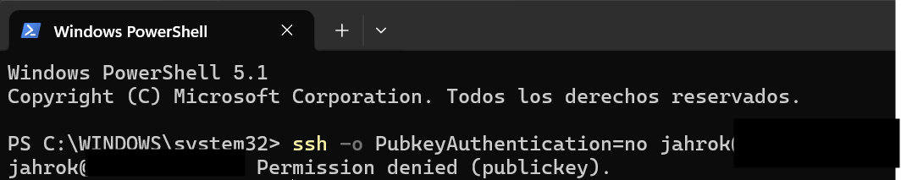
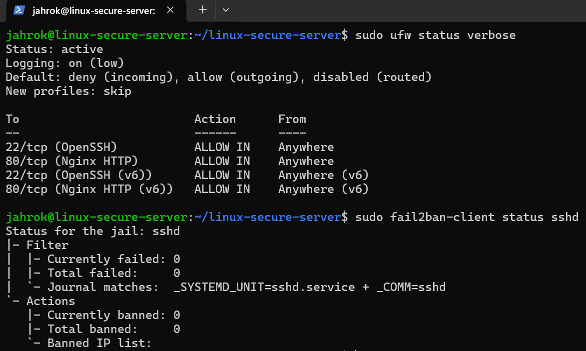
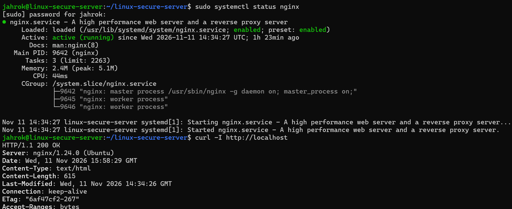
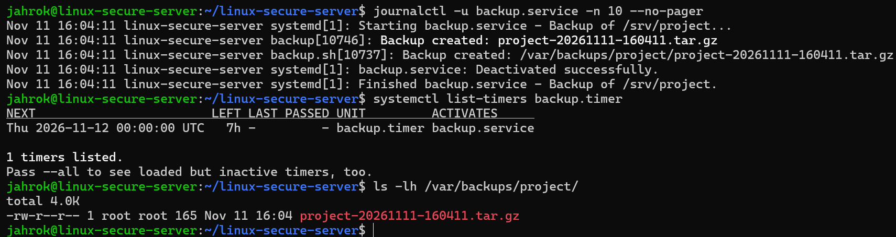

# Linux Secure Server

A hardened Ubuntu Server 24.04 built from scratch and fully automated with Bash:
least-privilege access control, key-only SSH, firewalling, brute-force protection,
and a custom systemd backup service.

## What it demonstrates

| Area | Implementation |
|------|----------------|
| Terminal / Bash | Idempotent setup scripts with `set -euo pipefail`, backup script with rotation |
| Permissions | Users/groups, setgid directory (2770), ACLs, scoped sudoers rule |
| Services | nginx, custom systemd service + timer for daily backups, journalctl logs |
| Security | SSH key-only auth, root login disabled, UFW firewall, fail2ban |

## Structure

```
scripts/            Automation scripts (run in numeric order)
config/             SSH hardening drop-in, systemd unit and timer
docs/screenshots/   Evidence of each verification step
```

## Usage

```bash
git clone https://github.com/jahrok/linux-secure-server.git
cd linux-secure-server && chmod +x scripts/*.sh
sudo ./scripts/01-setup-users.sh
# Set up SSH key login first, then:
sudo ./scripts/02-harden-ssh.sh
sudo ./scripts/03-firewall-fail2ban.sh
sudo install -m 755 scripts/backup.sh /usr/local/bin/backup.sh
sudo cp config/backup.* /etc/systemd/system/
sudo systemctl daemon-reload && sudo systemctl enable --now backup.timer
```

## Design decisions

- **Least privilege:** alice (devs) can write to /srv/project and only restart nginx; bob (auditors) is read-only through ACLs.
- **SSH drop-in named 00-:** sshd keeps the first value it reads, so this file takes precedence over cloud-init defaults.
- **Validate before applying:** `sshd -t` and `visudo -cf` catch errors before they cause a lockout.
- **systemd timer over cron:** logs go to the journal and `Persistent=true` runs missed jobs.

## Verification

### Permissions


### SSH hardening
Key-based login succeeds:



Password authentication is rejected, confirming key-only access:



### Firewall and fail2ban


### nginx


### Backup service and timer


## Roadmap

Infrastructure as code (Terraform, Ansible), CI/CD pipelines, centralized logging, and cloud deployment on AWS/GCP.

## Author

**jahrok** - Systems Engineer specializing in Cloud, DevOps and Cloud Security.

[LinkedIn](https://cr.linkedin.com/in/jarod-ugalde-slak-381015230) | [GitHub](https://github.com/jahrok)
